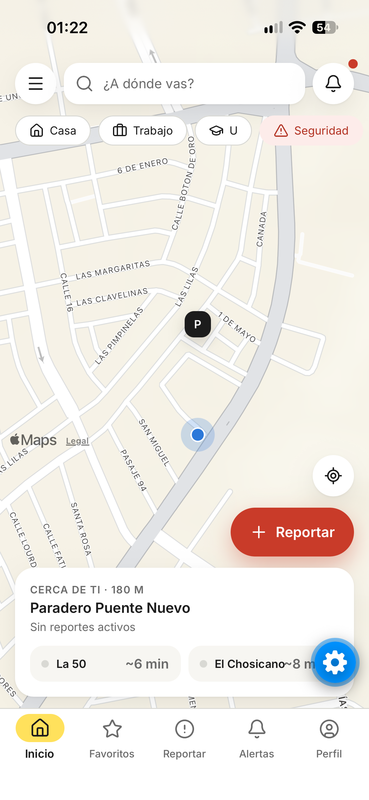
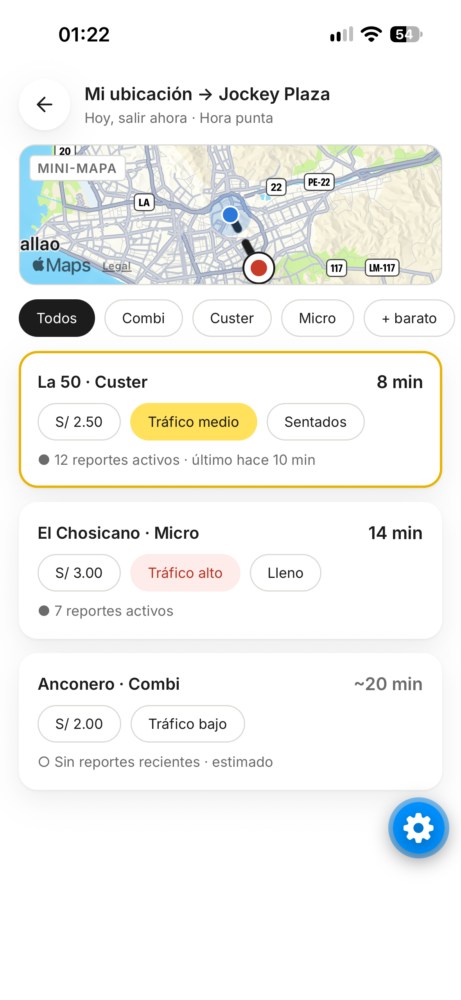
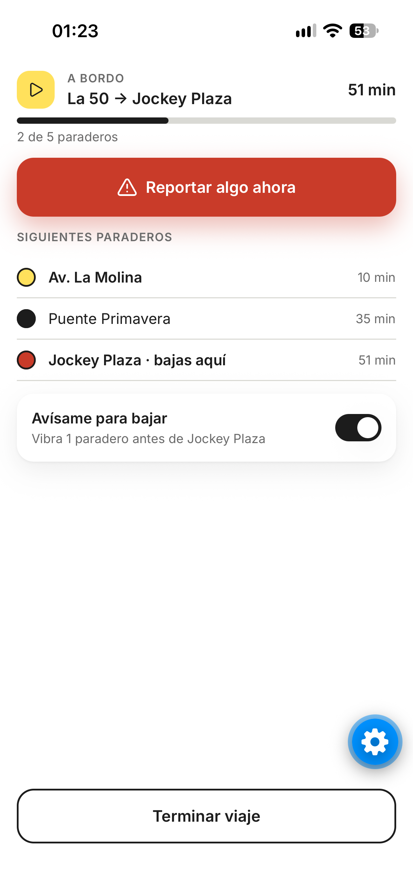
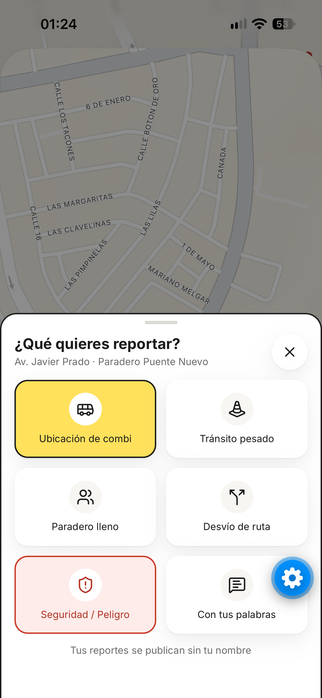
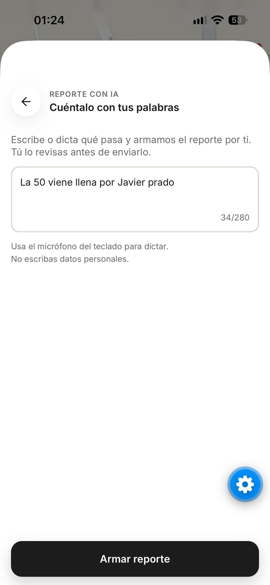
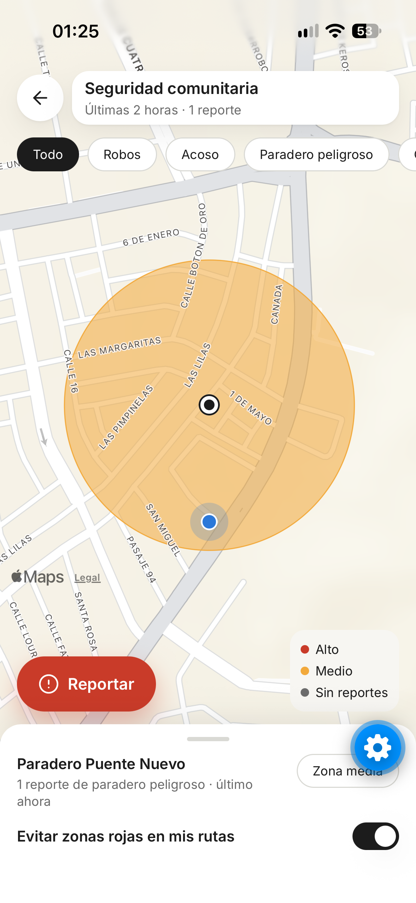
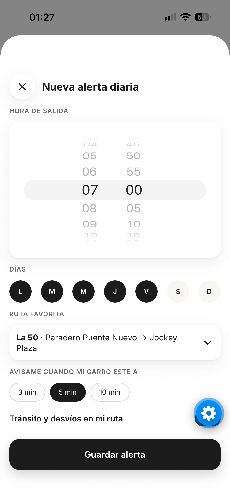
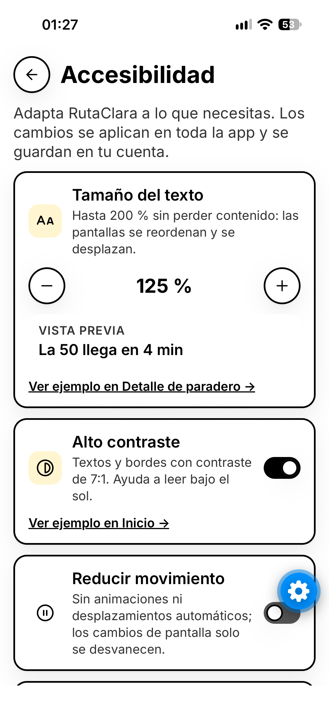
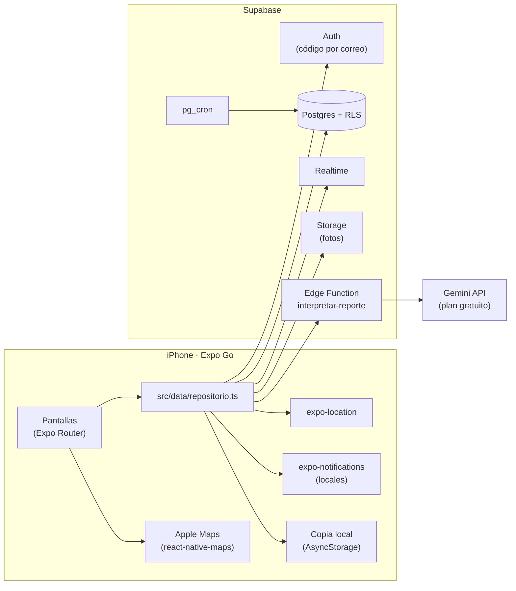

# RutaClara

App colaborativa para el transporte público informal de Lima. Los pasajeros reportan en tiempo real dónde vienen las combis, custers y micros, cuánto se espera en el paradero y qué alertas de seguridad hay en la ruta.

**Proyecto Final · Interacción Hombre-Máquina · Universidad Tecnológica del Perú (UTP) · 2026**
Alineado al **ODS 11: Ciudades y comunidades sostenibles**.

---

## Problema, público y propuesta de valor

- **Problema:** en Lima, quien usa combis y custers no sabe cuándo pasa su línea, cuán llena viene ni si el paradero es seguro. Esa información circula de boca en boca o en grupos de WhatsApp, y casi nunca llega a tiempo.
- **Público objetivo:** pasajeros diarios del transporte informal de Lima, que viajan al trabajo o a estudiar y necesitan decidir rápido y con una sola mano.
- **Propuesta de valor:** información **colaborativa y en tiempo real**. Los mismos pasajeros reportan la unidad, la espera y los peligros. Hay rutas con tiempos estimados, viaje en vivo, alertas diarias y un mapa de seguridad. La app es **accesible** e incluye **IA** para reportar o planear un viaje con tus propias palabras o con la voz.

## Modalidades del Proyecto Final

| Modalidad | Cómo se aplica |
|---|---|
| **Interfaces móviles (iPhone)** | App nativa con Expo para iPhone. Áreas táctiles de 44 pt y uso con una mano |
| **Mapas interactivos** | Mapa real (Apple Maps), arrastrar el pin para marcar un reporte, centrar en mí, zonas de seguridad y recorrido al destino |
| **Interfaces por voz** | Dictado del teclado en «Con tus palabras» y en el asistente de viaje |
| **+ IA** | «Reporte con tus palabras»: lenguaje natural o voz → borrador de reporte |
| **+ Agente de IA** | Asistente de viaje: interpreta la solicitud, decide la acción (buscar rutas o crear una alerta) y la ejecuta en la app; el usuario confirma antes de guardar |

## Funciones

| Flujo | Qué permite |
|---|---|
| **F1 · Búsqueda y viaje en vivo** | Buscar un destino, comparar líneas por tiempo y precio, ver el detalle de la ruta, esperar la unidad en vivo y recibir aviso para bajar |
| **F2 · Reporte colaborativo** | Reportar la ubicación y el estado de una unidad, un desvío, la espera en el paradero, el tránsito o un problema de seguridad (con alerta urgente). Puntos y logros |
| **F3 · Favoritos y alertas** | Guardar paraderos y líneas, configurar alertas diarias con recordatorio, centro de notificaciones y mapa de seguridad |
| **IA** | Reportar escribiendo o dictando; asistente que prepara la búsqueda o la alerta |
| **Cuenta** | Ingreso con código por correo, perfil, desactivar o eliminar la cuenta (con periodo de gracia) |
| **Accesibilidad** | Tema claro y oscuro, alto contraste, texto hasta 200 %, reducir movimiento y señales sin depender del color |

## Capturas

| Inicio | Rutas | Viaje en vivo | Reportar |
|---|---|---|---|
|  |  |  |  |

| Con tus palabras (IA) | Mapa de seguridad | Alerta diaria | Accesibilidad |
|---|---|---|---|
|  |  |  |  |

## Arquitectura



- **Una sola puerta a los datos:** las pantallas solo usan `src/data/repositorio.ts`. Solo `src/data/supabase.ts` importa el cliente de Supabase.
- **Seguridad:** todas las tablas tienen Row Level Security. Las columnas sensibles (puntos, eliminación de cuenta) cambian solo por funciones del servidor. La clave de la IA vive como secreto en Supabase, nunca en la app.
- **La IA solo propone:** completa un borrador o prepara una acción y abre la pantalla de siempre; el usuario revisa y confirma.
- **Sin conexión:** los reportes se guardan en una cola local y se envían solos al volver la red. El catálogo tiene copia local.

## Tecnologías

| Capa | Tecnologías |
|---|---|
| App | React Native 0.88 · Expo SDK 58 · TypeScript estricto · Expo Router |
| Interfaz | StyleSheet + tokens de diseño · Inter · lucide-react-native |
| Mapa y dispositivo | react-native-maps (Apple Maps) · expo-location · expo-notifications · expo-image-picker |
| Backend | Supabase: Auth (OTP por correo), PostgreSQL + RLS, Realtime, Storage, Edge Functions (Deno), pg_cron |
| IA | Google Gemini API (plan gratuito de AI Studio) · salida estructurada (JSON Schema) |
| Diseño | Figma (wireframes → alta fidelidad, sistema de diseño con tema claro, oscuro y alto contraste) |
| Calidad | ESLint · `tsc --noEmit` · expo-doctor |

## Accesibilidad y diseño inclusivo

- Tema **claro, oscuro y alto contraste**, con tokens de color para cada uno.
- **Texto hasta 200 %**: los controles crecen en vez de cortar el texto.
- **Reducir movimiento**: sin animaciones de cámara ni transiciones.
- **Señales sin depender del color**: íconos además del rojo y el amarillo.
- Etiquetas y roles para **VoiceOver**; el mapa es decorativo y la información está también en listas.
- Áreas táctiles de **44 pt** y grid de 8 pt.
- Estados vacíos, de error y sin conexión (E1–E10) con una salida clara.

## Cómo correrlo

**Requisitos:** Node.js 20 o superior, Git, un iPhone con **Expo Go** (SDK 58), una cuenta de [Supabase](https://supabase.com) y una clave gratuita de [Google AI Studio](https://aistudio.google.com) (solo para las funciones de IA).

1. **Clonar e instalar**
   ```bash
   git clone https://github.com/yimy322/ruta-clara.git
   cd ruta-clara
   npm install
   ```
2. **Variables de entorno:** copia `.env.example` como `.env.local` y completa la URL del proyecto y la **publishable key** de Supabase. Son claves públicas; nunca pongas la clave secreta ni la `service_role`.
3. **Base de datos:** en el SQL Editor de Supabase ejecuta, en orden, `supabase/migrations/001` → `008` y después `supabase/seed.sql`. Si pg_cron da error, actívalo en Database → Extensions.
4. **Ingreso con código:**
   - En Authentication → Email Templates, pega `supabase/plantillas/codigo.html` en «Magic link or OTP» y en «Confirm sign up».
   - Configura un SMTP propio (por ejemplo, Gmail con contraseña de aplicación).
5. **IA (opcional):**
   - En Edge Functions, crea `interpretar-reporte` con el código de `supabase/functions/interpretar-reporte/index.ts` y deja activado «Verify JWT».
   - En Secrets agrega `GEMINI_API_KEY` y, si quieres, `GEMINI_MODEL`.
6. **Iniciar**
   ```bash
   npx expo start
   ```
   Escanea el código QR con la cámara del iPhone. El celular y la computadora deben estar en la misma red; si no carga, usa `npx expo start --tunnel`.

La guía detallada de Supabase está en [`docs/ROADMAP.md`](docs/ROADMAP.md) (§5.0–5.2) y la de la IA en [`docs/PROMPTS_PENDIENTES.md`](docs/PROMPTS_PENDIENTES.md) (guía 7.0).

> **Demo:** la ubicación de prueba (Puente Nuevo, El Agustino) viene encendida para que se vean los datos de ejemplo desde cualquier lugar. Se cambia en Perfil → Desarrollo → «Ver datos» (solo en desarrollo).

## Comandos útiles

| Comando | Para qué sirve |
|---|---|
| `npx expo start` | Inicia el servidor de desarrollo |
| `npx expo start -c` | Inicia limpiando la caché |
| `npx expo install <paquete>` | Instala una librería compatible con el SDK |
| `npx tsc --noEmit` | Revisa los tipos de TypeScript |
| `npx expo lint` | Revisa el código con ESLint |
| `npx expo-doctor` | Verifica las dependencias del SDK |

## Estructura del proyecto

```
src/
├── app/          # Pantallas y rutas (Expo Router): tabs, reporte, viaje, cuenta, asistente…
├── components/   # Componentes reutilizables (Mapa, Button, Chip, CampoIA…)
├── config/       # Reglas y parámetros (puntos, insignias, simulación)
├── context/      # Estado compartido (sesión, tema, preferencias, viaje, reporte)
├── data/         # Repositorio y acceso a Supabase, ubicación y notificaciones
├── hooks/        # Hooks (tiempo real, permisos, avisos programados…)
├── mocks/        # Datos de ejemplo (fuente de supabase/seed.sql)
├── theme/        # Tokens de diseño: colores, tipografía, espaciados
├── types/        # Tipos del dominio
└── utils/        # Formato de textos y cálculos
supabase/
├── migrations/   # Esquema, RLS, funciones y cron (001–008)
├── functions/    # Edge Function interpretar-reporte (IA)
├── plantillas/   # Plantilla del correo con código
└── seed.sql      # Datos de ejemplo
docs/             # Hoja de ruta, contexto y decisiones, capturas
```

## Documentación y diseño

- [`docs/ROADMAP.md`](docs/ROADMAP.md): fases, estado y guías.
- [`docs/RUTACLARA_CONTEXT.md`](docs/RUTACLARA_CONTEXT.md): producto, reglas y **decisiones** del proyecto.
- Diseño en Figma (alta fidelidad y wireframes): [RutaClara](https://www.figma.com/design/scCnOTBkUv6axMpU4GiLwc/RutaClara).

## Avance

- [x] Fases 1–3: entorno, sistema de diseño y Flujo 1
- [x] Fase 4: Flujos 2 y 3, alta fidelidad, estados, tema dinámico, accesibilidad y cuenta
- [x] Fase 5: backend con Supabase (Auth, datos, tiempo real, Storage, cron)
- [x] Fase 6: mapa real, ubicación, mapa interactivo y notificaciones locales
- [x] Fase 7: IA (reporte con tus palabras y asistente de viaje)
- [ ] Fase 8: entrega (README, pruebas, PPT y demo)

## Problemas comunes

**"Project is incompatible with this version of Expo Go"**
La versión de Expo Go no coincide con el SDK del proyecto. Actualiza el proyecto al SDK que indica el mensaje, en una rama aparte:

```bash
npx expo install expo@^59.0.0 --fix
npx expo-doctor
```

**"Unable to resolve module…"**
Falta instalar una librería: `npx expo install <paquete>` y luego `npx expo start -c`.

**Error de `chrome-sandbox` al iniciar en Linux**
Afecta solo a React Native DevTools, no a la app:

```bash
sudo chown root:root "<ruta>/chrome-sandbox"
sudo chmod 4755 "<ruta>/chrome-sandbox"
```

---

**Autor:** Yimy Jhon Flores Hilares ([@yimy322](https://github.com/yimy322)) · Licencia [MIT](LICENSE)
Proyecto académico · Universidad Tecnológica del Perú · Interacción Hombre-Máquina · 2026
